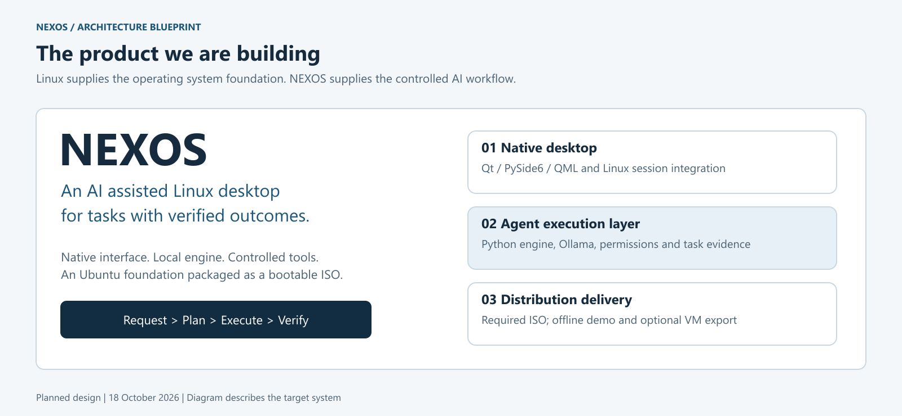
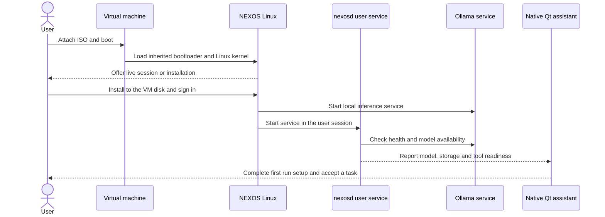
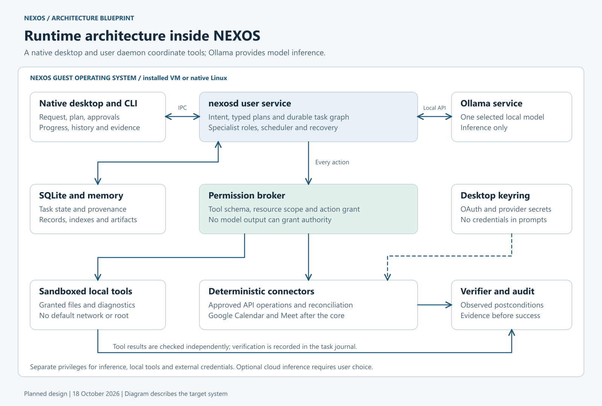
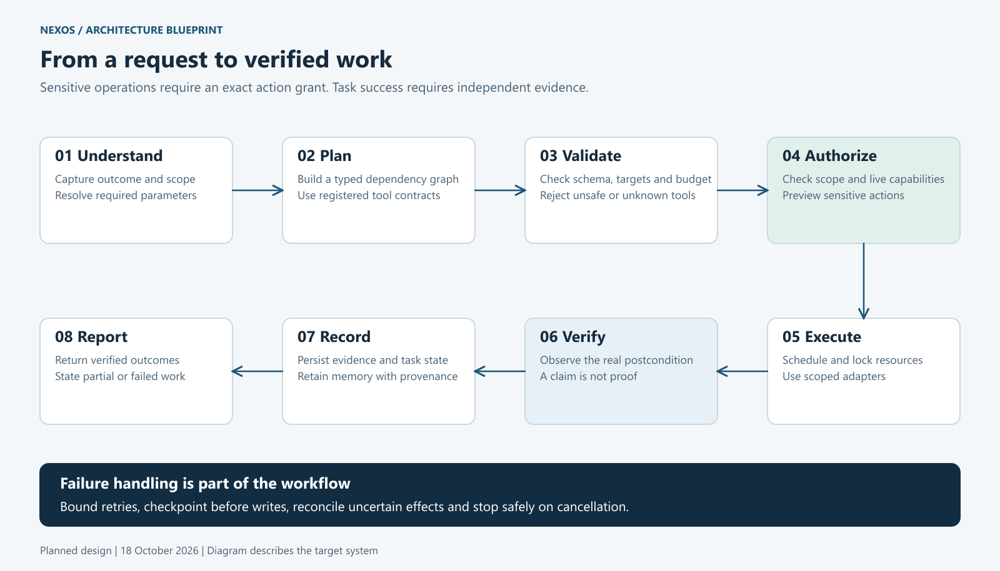
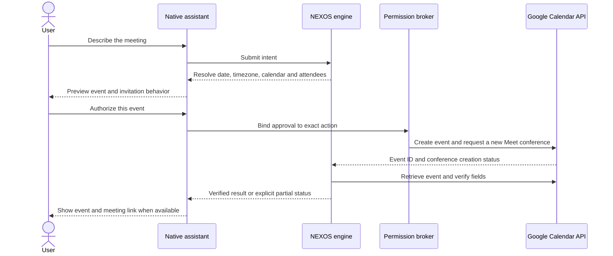
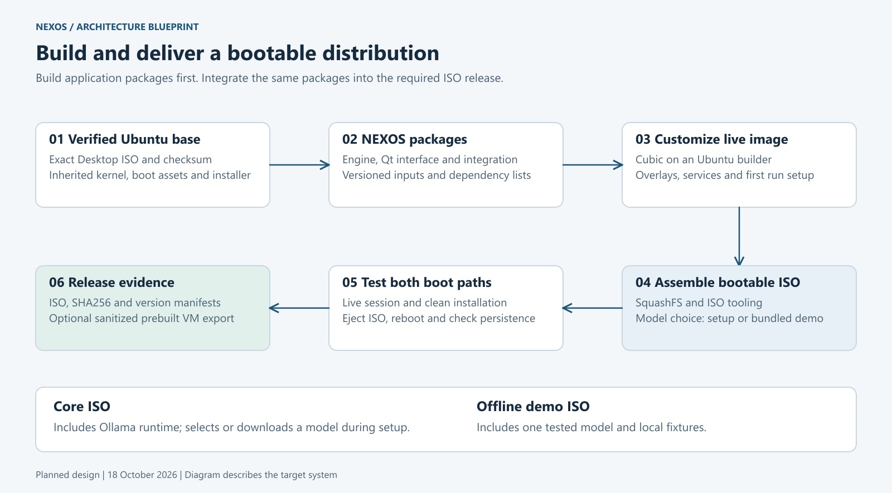

<div align="center">

# NEXOS

### An AI assisted Linux distribution for verified workstation automation

Describe an outcome. Review sensitive actions. Let the system execute and verify the work.

[Architecture](#system-architecture) · [Technology](#technology-stack) · [ISO delivery](#iso-and-vm-delivery) · [Workflows](#task-execution-workflow) · [Build roadmap](#implementation-roadmap)

</div>



**Project stage:** early implementation. A deterministic static diagnosis CLI, scoped filesystem access, report verification, SQLite task records and a foundation Debian package now work. Ten foundation tests pass on Windows and Ubuntu WSL. The model driven agents, native desktop, Linux worker sandbox and bootable ISO remain planned milestones. Diagrams describe the intended complete system.

**Current architecture decision:** Ubuntu 24.04 LTS, a native Qt desktop application, a Python background engine and Ollama, delivered together in a customized bootable ISO. This decision supersedes the earlier browser interface proposal and makes ISO delivery a release requirement. See [the decision record](docs/decisions/0001-native-desktop-and-iso.md).

## Project overview

NEXOS will combine an existing Linux operating system with a native interface for carrying out bounded tasks through AI agents. The user expresses a goal; NEXOS identifies the required resources, creates a structured plan, authorizes the actions, executes registered tools and checks the resulting state.

Ubuntu supplies the Linux kernel, boot process, drivers, desktop environment, networking and package management. NEXOS supplies the assistant interface, agent orchestration, application scheduler, permissions, controlled adapters, task memory, recovery and verification.

The intended product is an Ubuntu based distribution with an integrated AI workstation experience. The project develops user space software and distribution integration; it reuses the upstream kernel and desktop.

### Project objectives

- Complete selected workstation tasks from natural language with observable results.
- Integrate the assistant into the Linux desktop and user session.
- Keep task execution within explicit tool and resource permissions.
- Preserve task state, useful context and evidence across sessions.
- Produce a bootable ISO that can be tested and installed in a VM.
- Evaluate task success, permission enforcement, resource usage and recovery.

### Planned first release workflows

1. Locate a development project in folders the user has granted access to.
2. Inspect its runtime, dependency manifest and prepared diagnostic information.
3. Create a diagnosis report in an approved output directory and verify its contents.
4. Perform selected file operations and inspect named user services.
5. Add a Google Calendar and Meet connector once the shared execution boundary is stable.

Voice input, general desktop control, autonomous package installation and broader application support are later features. The first release will demonstrate a small set of complete workflows.

### Run the current foundation

With Python 3.12 in Ubuntu, run these commands from the repository root:

```bash
python3 tools/run_nexos.py doctor --workspace .
python3 tools/run_nexos.py diagnose --project examples/demo-project --output .nexos/reports --state .nexos/state.sqlite3
python3 -m unittest discover -s tests -v
```

The current command performs static manifest inspection using a fixed plan. It creates a report, verifies its hash and source evidence, and persists the outcome. Project code and network operations are outside this checkpoint; OS sandboxing is not yet implemented. The fixture is metadata, not a running application.

The first Linux package can be built and checked without installing it:

```bash
python3 tools/build_foundation_deb.py
python3 tools/check_foundation_package.py
```

See the [build workflow](docs/build/BUILD_WORKFLOW.md) and [presentation script for 20 October](docs/presentation/NEXOS_Presentation_Script.md).

## ISO and VM delivery

### What the downloads mean

An **ISO** is bootable media. Attach it to a new compatible virtual machine to start a live session or run an installer. A **prebuilt VM** already has an installed operating system on a virtual disk, together with machine configuration or appliance metadata. Kali offers both forms of delivery; its [official download guidance](https://www.kali.org/docs/introduction/download-official-kali-linux-images/) explains the prebuilt option.

NEXOS will target these artifacts, in this order:

1. **Native Debian packages** for installing and updating the NEXOS components on the chosen Ubuntu base. These are intermediate building blocks and development artifacts.
2. **NEXOS Core ISO**, the required release artifact: Ubuntu, desktop integration, native assistant, engine, Ollama runtime and first run configuration. Model weights are selected and downloaded during setup.
3. **NEXOS Offline Demo ISO**, a release variant with one tested local model and prepared sample projects, after checking storage, model redistribution terms and offline behavior.
4. **Prebuilt VMware image**, an optional convenience export created from a clean installation of the same release. An OVF or OVA appliance is a possible additional export, subject to import testing.

These are planned artifact names and roles. No release download is available yet. The Core ISO contains the inference runtime, but requires a model download or configured cloud connection before AI inference is available. The offline demo includes weights; external services such as Google Calendar still need internet access and account authorization.

### Where the backend runs

Everything required for local execution is installed **inside the NEXOS guest operating system**:

- The Qt application runs in the logged in user's desktop session.
- `nexosd` runs as a systemd user service and owns task orchestration.
- Ollama runs as a local service under a dedicated service account.
- SQLite, task artifacts and memory live on the guest's installed virtual disk.
- Tool workers run inside the guest with scoped permissions and sandbox profiles.

There is no required hosted NEXOS backend. Optional cloud model providers and external connectors are remote services explicitly selected by the user. A local Ollama HTTP endpoint is an internal inference interface, not a website or hosted application. Ollama documents its [Linux service setup](https://docs.ollama.com/linux) and [local API](https://docs.ollama.com/api/introduction).

### Boot and first run



A live session normally uses temporary writable state and loses changes on shutdown unless persistence is explicitly configured. Installing to a VM disk provides the normal persistent development and demonstration environment. A live session must clearly identify its temporary storage; it must not silently store important task history in a disposable overlay.

Initial compatibility target: **x86_64 VMware Workstation with UEFI**, with the exact host and hypervisor versions recorded during testing. VirtualBox and QEMU are secondary test targets. Hardware virtualization, sufficient resources and compatible virtual hardware are prerequisites. Universal support for every VMware version or physical computer is not a release claim. Secure Boot requires a separately validated signing and boot chain; the prototype target uses Secure Boot disabled in the test VM.

## Technology stack

The primary interface is a native Linux desktop application. The recommended stack keeps most application logic in Python and uses Qt for the desktop presentation.

| Layer | Selected technology | Responsibility |
| --- | --- | --- |
| Operating system base | Ubuntu 24.04 LTS x86_64 | Kernel, drivers, packages and hardware support |
| Existing desktop | GNOME and normal Ubuntu session | Windows, desktop applications and session lifecycle |
| Native assistant interface | Qt 6, PySide6 and Qt Quick/QML | Request panel, plans, approvals, progress and history |
| Background engine | Python 3.12 and `asyncio` | Intent handling, scheduler, orchestration and cancellation |
| Local application transport | Unix domain socket and versioned JSON messages | Native UI and CLI communication with the user daemon |
| Typed contracts | Pydantic and JSON Schema | Intent, plan, tool and result validation |
| Local inference | Ollama with one benchmarked small model | Model loading and inference |
| Agent orchestration | Project owned Python state machine and DAG scheduler | Explicit specialist roles, dependencies, limits and recovery |
| Durable state | SQLite and transactional migrations | Tasks, attempts, approvals, memory metadata and audit references |
| Retrieval | SQLite FTS5; local embeddings after basic retrieval | Search over granted project material |
| Execution boundary | Typed adapters, Bubblewrap and verified systemd limits | Scoped filesystem access, isolated subprocesses and resource limits |
| Linux integration | systemd user units, allowlisted D Bus calls and file watchers | Startup, notifications, selected service operations and indexing |
| Credential storage | Linux Secret Service/keyring | OAuth refresh tokens and optional provider keys |
| Web service integration | Google APIs with OAuth; Playwright for a later bounded fallback | Authorized remote actions and verification |
| Application packaging | `.deb`, `dpkg-deb` and explicit dependency manifests | Installable engine, interface and integration packages |
| ISO prototyping | Cubic on an Ubuntu Linux builder | Customize the selected Ubuntu live image |
| Image build tools | SquashFS tooling, xorriso and inherited Ubuntu boot assets | Filesystem packing and bootable image assembly |
| Verification | pytest, adapter integration tests and clean VM boot/install tests | Functional, security, recovery and distribution evidence |

[Qt for Python](https://doc.qt.io/qtforpython-6/) provides the desktop bindings, and [QLocalSocket](https://doc.qt.io/qtforpython-6/PySide6/QtNetwork/QLocalSocket.html) supports local communication. The Python service can use [asyncio Unix streams](https://docs.python.org/3.12/library/asyncio-stream.html). Cubic is the maintainers' [Custom Ubuntu ISO Creator](https://github.com/PJ-Singh-001/Cubic).

React, Next.js and FastAPI are not required in this architecture. A native application can still use structured internal APIs. PostgreSQL, Qdrant, Redis and Kubernetes are unnecessary for the initial single machine prototype. One orchestration implementation is easier to measure and recover than several overlapping agent frameworks.

## System architecture



[Open the vector architecture diagram](docs/assets/nexos-architecture.svg).

### Desktop interface

The assistant window contains a request composer, a plan view, progress and cancellation controls, an action preview for sensitive changes, and a result view with evidence. History and connected services are separate views. Desktop notifications report completion and requests for attention.

The interface remains responsive while inference or tools run. Prefer Qt controls with keyboard navigation, visible focus, accessible labels and explicit error states. The UI cannot grant itself capabilities or declare a task successful.

### Local engine

`nexosd` owns the authoritative state machine. It parses intent, validates model proposals, schedules ready steps, requests authorization, dispatches adapters and records verification results. Closing the assistant window does not erase an active task; the user daemon continues within the session's lifecycle and stored limits.

The proposed socket is `$XDG_RUNTIME_DIR/nexos/control.sock`, inside a directory restricted to the user. Use framed JSON messages with request identifiers, a protocol version, bounded message sizes and explicit event types. Verify peer identity and resource scope. Same account malware remains outside this boundary's threat model.

### Model service

Ollama loads and runs a model. NEXOS implements the agents, tool registration, permission checks and verification. Multiple specialist roles can reuse one loaded model; each role receives only its relevant context and permitted tool descriptions.

The model gateway uses `http://127.0.0.1:11434` inside the guest for local inference. Keep it on guest loopback and do not forward it to the LAN. Use schema constrained outputs where supported and validate every response in application code. [Structured outputs](https://docs.ollama.com/capabilities/structured-outputs) constrain shape; they do not prove that a plan is correct or safe. [Tool calling](https://docs.ollama.com/capabilities/tool-calling) proposes tool requests; the broker still decides whether they can run.

### Execution and verification

The broker accepts only registered tools with validated arguments and an active capability for the target resource. Local tools run with the filesystem and network profile needed for that action. External connectors perform deterministic API operations using credential handles from the keyring.

After execution, an independent verifier checks the intended outcome. Task success depends on evidence such as an expected report, file hash, observed service state or retrieved calendar event. Model generated text is not the success oracle.

## Task execution workflow



[Open the vector workflow diagram](docs/assets/nexos-task-workflow.svg).

1. **Understand** the outcome, target resources, constraints and required parameters.
2. **Clarify** only missing information that affects correctness or authority.
3. **Plan** a dependency graph using registered tool identifiers and typed arguments.
4. **Validate** tool schemas, paths, dependencies, budgets and verification rules.
5. **Authorize** each action at its actual resource and risk level.
6. **Schedule and execute** ready work under concurrency limits and resource locks.
7. **Verify** postconditions through separate observations.
8. **Persist and report** verified results, unresolved work and audit evidence.

Task states include `RECEIVED`, `NEEDS_INPUT`, `PLANNED`, `WAITING_APPROVAL`, `QUEUED`, `RUNNING`, `VERIFYING`, `SUCCEEDED`, `PARTIAL`, `FAILED` and `CANCELLED`. Each step also has an attempt record. A timeout after an external write produces reconciliation work, not an automatic duplicate write.

### Agent roles

- **Supervisor:** interprets requests and proposes or revises bounded plans.
- **File agent:** locates and reads granted files and proposes scoped operations.
- **Diagnostics agent:** inspects runtimes, manifests, prepared logs and named user services.
- **Workflow agent:** executes reviewed, versioned recipes.
- **Productivity agent:** prepares calendar and other approved connector actions.

The scheduler orders ready steps by priority and FIFO with waiting time aging. Start with one inference request, at most two local read workers and one write per resource. Cooperative cancellation stops at safe boundaries. NEXOS scheduling coordinates application work; Linux still schedules CPU processes.

### Example diagnosis

> Find the demo API project, inspect its runtime and dependency manifest, and save a diagnosis report. Ask before changing project files.

The file agent identifies the correct project; diagnostic adapters read its known metadata; the report adapter writes only to an approved output location; a verifier checks required report sections and fixture state. Running repository tests or package installation scripts is a separate code execution capability, even when the user only asked for a diagnosis.

### Example meeting request

> Schedule a 30 minute project review tomorrow at 5 PM with these two email addresses and add a Google Meet link.



Use the official Calendar API with OAuth rather than searching for the Google homepage. The connector requests event creation with `conferenceDataVersion=1` and new conference data. Confirm time, timezone, attendees and notification behavior. Persist operation identity before the write, reconcile uncertain results and wait for conference readiness before claiming complete success. The [event insertion reference](https://developers.google.com/workspace/calendar/api/v3/reference/events/insert) defines conference creation and invitation options. Event creation does not prove that guests accepted an invitation.

## Permissions and isolation

The model proposes an action; deterministic application code decides whether the action is authorized.

| Tier | Example | Initial behavior |
| --- | --- | --- |
| T0 Observe | Read a granted file or inspect a named user service | Allowed inside the granted scope |
| T1 Scoped write | Create a new report in an approved folder | Allowed under a task specific capability; existing file overwrite requires approval |
| T2 Sensitive action | Send invitations, edit project files or restart a demo user service | Show exact effect and obtain a short lived grant |
| T3 Critical action | Root commands, disk changes or broad destructive operations | Denied in the first release |

Grants bind to task, tool, resource, canonical arguments, plan version and expiry. A changed recipient, path or command invalidates the authorization. Reading private data does not authorize uploading it or sending it to cloud inference.

Use argument arrays and native APIs instead of generated shell strings. Workers receive only approved files, a temporary work area and narrow broker access. They must not inherit the full home directory, SSH agent, desktop session bus, host sockets or connector credentials. Local inspection has network denied by default.

[Bubblewrap](https://github.com/containers/bubblewrap) supplies sandbox construction primitives. The project must define and test a real policy, check Ubuntu user namespace compatibility and verify effective resource limits. Missing isolation disables affected execution rather than triggering unrestricted fallback.

Audit records contain redacted action details, authorization decisions, timestamps, outcomes and verification evidence. A hash chain supports tamper evidence under declared trust assumptions; it does not make a local journal immutable against the host administrator or a fully compromised user account.

## Memory and persistence

Four logical categories share a small initial persistence layer:

- **Working:** bounded context for the current task.
- **Episodic:** previous task outcomes and evidence references.
- **Semantic:** indexed facts from granted project material.
- **Procedural:** reviewed workflows and tool recipes.

SQLite holds task, plan, attempt, grant, artifact and memory metadata. FTS5 provides full text retrieval. Add local embeddings only after exact and full text retrieval work; use a bounded in process vector search before adopting another database.

Every durable memory item records source, owner, timestamp, sensitivity, expiry and trust status. Retrieved documents cannot grant permission or install workflows. Source deletion invalidates derived indexes and embeddings.

Planned installed system locations:

```text
~/.config/nexos/                     User settings and model route
~/.local/share/nexos/nexos.sqlite3   Tasks and memory metadata
~/.local/share/nexos/artifacts/      Reports and verification artifacts
~/.local/state/nexos/                Redacted audit and diagnostic records
$XDG_RUNTIME_DIR/nexos/              Private control socket
/var/lib/ollama/models/              Service owned model storage
```

The package will configure `OLLAMA_MODELS` for the chosen service directory and its ownership. Credentials belong in the desktop keyring, outside these records and outside the ISO. These paths are design conventions, not evidence of an installed runtime.

## Building the distribution image



[Open the vector image build diagram](docs/assets/nexos-iso-pipeline.svg).

### Build sequence

1. **Verify the base.** Select an exact Ubuntu 24.04 Desktop image and record its published checksum, image version and package sources.
2. **Package NEXOS.** Build proposed `nexos-engine`, `nexos-desktop` and `nexos-integration` packages from a recorded source revision. Package dependencies and preserve applicable upstream notices.
3. **Prepare the image.** Use Cubic on an Ubuntu builder for the first remaster. Apply version controlled package lists, customization scripts and filesystem overlays rather than relying on undocumented manual changes.
4. **Configure integration.** Add launcher, theme assets, user session startup, inference service, first run checks and safe defaults. Do not capture a developer's active home directory as an image template.
5. **Choose model content.** Keep weights outside the Core ISO. For the offline demo, include one reviewed model with a recorded digest and redistribution permission; prevent the installer from silently removing the required runtime or weights.
6. **Assemble boot media.** Preserve the appropriate Ubuntu live boot and installer chain. Rebuild filesystem and ISO structures with the selected tool versions. A renamed ISO or archived application folder is not a bootable distribution.
7. **Test live and installed systems separately.** Verify the assistant in the live session, then install to an empty VM disk, eject the ISO, reboot and verify startup and persistence from that disk.
8. **Create release evidence.** Publish the tested ISO, SHA256 manifest, source and package manifest, model manifest where applicable, VM settings and known limitations. Optional VM exports come from a sanitized installed release.

### Build environment and reproducibility

ISO customization runs on Linux. We can begin with a dedicated Ubuntu build VM on the Windows laptop and later use another Linux builder if storage is tight. The image and its installed system must contain the NEXOS engine; using a separate build machine does not create a remote runtime dependency.

Cubic is the first image construction tool. Record its version, base checksum, package versions, customization inputs and output checksum. The initial goal is a repeatable, auditable build and behaviorally equivalent installation. Bit for bit reproducibility requires additional timestamp, repository snapshot and build environment controls and is not assumed.

The Ubuntu installer must be tested for the selected remaster. A live desktop that boots successfully is not proof that installed packages, autostart integration and model content survive installation. The project retains upstream boot components instead of writing a bootloader or kernel.

### First run experience

The setup flow checks disk space and tool isolation, selects local or cloud inference, verifies a local model or offers a download, requests access to project folders and optionally connects a test calendar. Cloud use requires an explicit choice. It displays ready, unavailable and setup required states for individual capabilities.

No personal provider keys, OAuth refresh tokens, browser sessions or private project data ship in the image. Create user state and credentials after installation. Live sessions must explain the persistence limitation before storing connected account state.

## Hardware and storage planning

**Available development laptop:** 16 GB RAM and an RTX 3050. The initial reported D drive free space was 60 GB; a 19 October environment check observed approximately 94.3 GiB free. Exact CPU capacity and dedicated GPU memory remain to be checked.

### Prototype allocation

- Start with one Ubuntu VM using about 4 vCPUs when available, 6 GB RAM and a dynamic disk capped near 38 GB.
- Keep approximately 15 GB of host storage free and limit snapshots to a small explicit budget.
- Use cloud inference as an optional development path or test a single small CPU model. Do not promise low latency on CPU.
- Keep the planned local model in roughly the 1 to 3 billion parameter class initially, subject to structured output and tool quality evaluation.

VM graphics acceleration does not establish access to the host GPU for CUDA inference. Treat ordinary VMware testing as CPU inference unless GPU compute exposure is independently verified. Your RTX 3050 may help a native Linux installation, subject to drivers and available VRAM; see [Ollama hardware support](https://docs.ollama.com/gpu).

### ISO build capacity

The initial 60 GB budget supported a constrained prototype; the latest approximately 94 GiB free is closer to an image build allowance. A VM, extracted filesystem, compressed copies, models and release artifacts still compete for space. Plan roughly **100 to 120 GB of free build workspace** for a comfortable image build cycle, or use a separate Linux builder and copy back only the final artifacts. This is an engineering allowance to validate with measured disk usage, not a mandatory hardware purchase.

Core ISO sizing may be around 5 to 8 GB; a model bundled demo could be around 7 to 12 GB. These are preliminary estimates dependent on base image, Qt libraries, packages and model choice. Installed disk capacity and VM RAM require separate measurement. No download size or minimum hardware specification is final until the built image is tested.

## Implementation roadmap

The working sequence builds the engine first and packages it into the required ISO. A provisional 16 week plan can be adjusted to the actual team and deadline.

| Milestone | Intended result | Completion evidence |
| --- | --- | --- |
| 1 Foundation | Tool schemas, policy rules, fixtures and one sandboxed observation | Real Linux boundary and path tests pass |
| 2 Deterministic execution | Diagnosis recipe, report writer, verifier and SQLite journal | Complete request to verified report without a model |
| 3 Model integration | Ollama gateway, intent parsing and validated plans | Malformed or unauthorized model output is rejected |
| 4 Durable agents | Specialist roles, DAG scheduling, locks and bounded recovery | No duplicate write after a forced restart |
| 5 Native desktop | Qt application, private socket and user service startup | Workflow completes through the desktop interface |
| 6 Connected workflow | OAuth test calendar adapter and event verification | Correct event and conference or explicit partial result |
| 7 Image prototype | Debian packages and bootable customized ISO | Live session and clean VM installation both work |
| 8 Release validation | Held out benchmark, sanitized image and release manifests | Reboot, persistence, offline and safety evidence recorded |

Keep a small early boot prototype to expose image integration problems. Release qualification follows a stable runtime. Development packages remain useful for fast iteration and updates after the ISO is produced.

## Testing and release criteria

### Functional and safety evaluation

Plan a 100 case benchmark with separate results for 50 functional cases, 20 permission cases, 15 adversarial content cases and 15 failure or restart cases. Use held out requests and deterministic postcondition oracles. Compare a manual workflow, a deterministic recipe and an agent baseline with matched tool access and permissions.

Measure verified task success, false claims of success, unauthorized side effects, manual interactions, latency, peak RAM, GPU memory where available, disk growth and inference cost. Performance targets remain targets until measured. Zero observed violations in a finite suite is a bounded result.

### ISO release gate

- The declared VM configuration boots the ISO in the chosen firmware mode.
- The live assistant opens and honestly reports model and tool readiness.
- Installation to an empty VM disk retains required NEXOS components.
- After ejecting the ISO, reboot succeeds and the user service starts at login.
- Task history, reports and configured model state survive a second reboot.
- The offline variant performs its declared local task with networking disconnected.
- External writes require a matching grant and reconcile timeouts without duplication.
- Sandbox failures disable execution, and private host data is inaccessible to workers.
- No personal credentials or active developer sessions are present in the release image.
- Checksums, package lists, model metadata and known VM limitations accompany the release.

CPU, RAM, disk and hypervisor measurements determine the published requirements. Passing an application unit test alone does not qualify the ISO.

## Repository layout

Current foundation, documentation and authoring tools:

```text
README.md
pyproject.toml
src/nexos/                                 Static diagnosis CLI and filesystem capabilities
tests/test_foundation.py                   Ten foundation tests
examples/demo-project/                     Static manifest fixture
image/                                    Base metadata and image preparation inputs
docs/
  assets/                                  Original diagrams in PNG and SVG
  decisions/0001-native-desktop-and-iso.md   Current desktop and delivery decision
  build/BUILD_WORKFLOW.md                   Current checkpoint and next build gates
  presentation/NEXOS_Presentation_Script.md  Proposal speech and faculty questions
  NEXOS_Architecture_and_Build_Plan.md       Earlier detailed architecture reference
output/pdf/
  NEXOS_Architecture_and_Build_Plan.pdf      Earlier architecture PDF
tools/
  run_nexos.py                              Local source entry point
  build_foundation_deb.py                    Linux foundation package builder
  check_foundation_package.py               Extracted package smoke test
  build_readme_diagrams.mjs                 Diagram source and rendering
  build_architecture_pdf.py                 Earlier report authoring tool
  verify_architecture_pdf.py                Earlier report verification tool
```

Planned expansion of the runtime and distribution structure:

```text
apps/desktop/                 PySide6 application and QML views
src/nexos/
  daemon/                     User service and private socket transport
  core/                       Intent, plans, DAG scheduler and task lifecycle
  agents/                     Role definitions and bounded context
  models/                     Ollama and optional cloud gateway
  security/                   Policy, grants, broker and sandbox launcher
  adapters/                   File, diagnostics, reports and calendar tools
  verification/               Independent postcondition checks
  memory/                     SQLite records, migrations and retrieval
workflows/                    Reviewed declarative recipes
packaging/debian/              Native package definitions
packaging/systemd/             User and inference service integration
image/                        Package lists, overlays and customization inputs
benchmarks/                   Fixtures, oracles and evaluation runner
tests/                        Unit, integration and VM validation
```

The expanded directories above are architectural conventions. The current flat `src/nexos` foundation and commands are described in the quick start. Full service installation and ISO assembly commands will be documented once implemented and tested.

## Documentation and design decisions

- [Current native desktop and ISO decision](docs/decisions/0001-native-desktop-and-iso.md)
- [Presentation script and faculty questions](docs/presentation/NEXOS_Presentation_Script.md)
- [Current build workflow](docs/build/BUILD_WORKFLOW.md)
- [Earlier detailed architecture document](docs/NEXOS_Architecture_and_Build_Plan.md)
- [Earlier architecture PDF](output/pdf/NEXOS_Architecture_and_Build_Plan.pdf)
- [Overview vector artwork](docs/assets/nexos-overview.svg)
- [Runtime architecture vector diagram](docs/assets/nexos-architecture.svg)
- [Task workflow vector diagram](docs/assets/nexos-task-workflow.svg)
- [Image build vector diagram](docs/assets/nexos-iso-pipeline.svg)

The earlier report remains useful for the security model, bounded workflows and evaluation. This README and the decision record take precedence for the native UI, local transport, required ISO and revised build storage budget.

## Development conventions

Keep models behind a gateway, tools behind the permission broker and task success behind a verifier. Version tool schemas and database migrations. Add capabilities through reviewed adapters and include their verification rule and failure behavior. Keep credentials, model downloads, VM disks and image build outputs outside source control.

Use concise, reproducible issue descriptions and changes with evidence appropriate to the affected layer. Public redistribution requires a chosen project license, preserved upstream notices and review of bundled model terms. The repository does not currently declare an application license or claim ownership of the underlying Linux components.

## Primary technical references

- [Ubuntu release lifecycle](https://ubuntu.com/about/release-cycle)
- [Cubic project and image customization](https://github.com/PJ-Singh-001/Cubic)
- [Qt for Python](https://doc.qt.io/qtforpython-6/)
- [Qt local socket transport](https://doc.qt.io/qtforpython-6/PySide6/QtNetwork/QLocalSocket.html)
- [Python asynchronous streams](https://docs.python.org/3.12/library/asyncio-stream.html)
- [Ollama Linux service](https://docs.ollama.com/linux)
- [Ollama API](https://docs.ollama.com/api/introduction)
- [Ollama tool calling](https://docs.ollama.com/capabilities/tool-calling)
- [Ollama structured outputs](https://docs.ollama.com/capabilities/structured-outputs)
- [Ollama hardware support](https://docs.ollama.com/gpu)
- [Bubblewrap security model](https://github.com/containers/bubblewrap)
- [SQLite FTS5](https://www.sqlite.org/fts5.html)
- [Google Calendar event insertion](https://developers.google.com/workspace/calendar/api/v3/reference/events/insert)

Implementation checkpoint updated 19 October 2026. Platform facts are grounded in the linked primary documentation; sizing and project milestones are proposed engineering decisions awaiting implementation measurements. Foundation test results do not establish full agent or ISO readiness.
