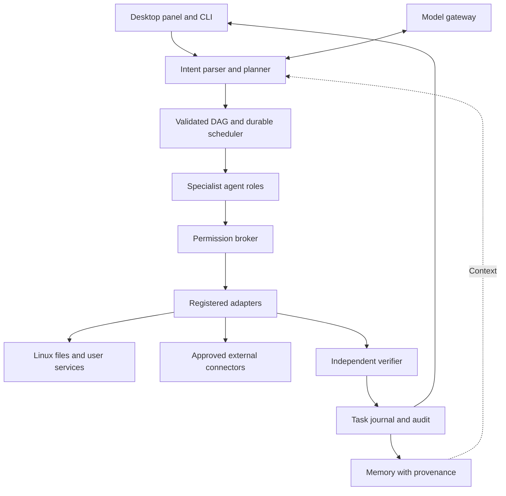
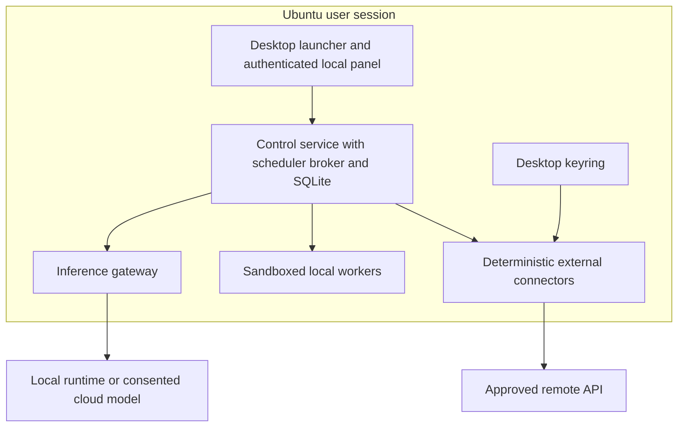

# NEXOS Architecture and Build Plan

## An AI assisted Linux desktop with secure task execution

Architecture version 1.0 · 18 October 2026

**Recommended academic title:** NEXOS A Secure Agentic Task Execution Layer for Linux Workstations

NEXOS will let a user describe an outcome, review a plan when necessary, and receive evidence that the computer completed the requested task. We will build it on Ubuntu 24.04 LTS using the existing Linux kernel, desktop, drivers, networking and package management. Our contribution is the intent interface, task planner, agent scheduler, permission broker, controlled tools, persistent task state and verification system.

The first release will focus on diagnosing a development project and creating a verified report. It will also demonstrate selected file operations and an optional Google Calendar and Meet workflow. The same architecture can support more workflows after those foundations work reliably.

**Your available hardware:** a laptop with 16 GB RAM, an RTX 3050 and approximately 60 GB free on D:. This is sufficient for a constrained starting setup. Start with one small Ubuntu VM and cloud inference, or a small local model only after a hardware test. Do not buy hardware before measuring the prototype.

**The result we are aiming for:** an installable Linux application and user service that perform bounded actions, survive interruptions and expose a clear audit trail. A branded bootable image can follow the working application. Kernel development, unrestricted root control and universal desktop automation are outside the first release.

**Planning assumption:** the roadmap uses 16 weeks and four workstreams. It can be reassigned once team size and the submission deadline are confirmed. All resource figures and performance thresholds in this document are engineering estimates or proposed targets, not measured results.

**Reading guide:** architecture and deployment on pages 5 to 6; agents and execution on pages 8 to 10; meeting scheduling on page 11; hardware and storage on pages 16 to 17; roadmap and evaluation on pages 18 to 20. The PDF also contains section bookmarks.

---

# 1 Project definition and academic contribution

## What we are building

A Linux distribution combines a kernel with system software, packages and a desktop environment. Kali and Ubuntu are distributions. NEXOS will initially be an AI task execution environment installed on Ubuntu. Its architecture runs in user space, above the kernel. The name can express an AI powered OS experience, while the technical report should state the implementation boundary precisely.

We will reuse Ubuntu for boot, memory management, process scheduling, hardware support, filesystem permissions and networking. We will build the components that translate a request into authorized, observable work. Ubuntu 24.04 is retained because both supplied plans use it, and its standard security maintenance extends to May 2029. [R1]

## The problem and research question

Developers repeatedly search for projects, inspect dependencies, read logs, check services and produce diagnostic reports. These activities cross several tools and often leave little record of what was checked.

**Research question:** can a bounded natural language execution layer reduce manual interactions and completion time for Linux workstation tasks while preserving permission boundaries and independently verifying results?

The academic contribution is the combined implementation and evaluation: structured plans, a dependency scheduler, enforceable tool capabilities, checkpoint recovery and machine checked outcomes. Each component should have a measurable purpose. Merely combining a chat box with a shell is insufficient evidence for this contribution.

## How to demonstrate an OS experience

Provide a desktop launcher, a task panel, Linux notifications, a user service started at login, file and user service adapters, resource limits and a native installer. Users should see ongoing work, approvals, cancellation and results in the same interface. They can continue using normal Ubuntu applications.

Kali is optimized for penetration testing and security auditing. Its own guidance discourages choosing it as a general development desktop. It adds no necessary foundation for these workflows. [R2]

---

# 2 Refinements to the existing project documents

The spreadsheet supplies a broad module list and the PDF supplies a narrower developer workflow and security model. Preserve that direction, with the following engineering refinements. Source locators refer to the original supplied files. [S1, S2]

| Existing proposal | Architecture decision |
| --- | --- |
| AI powered operating system | Implement a user space Linux execution layer first; describe the reused kernel accurately. |
| FIFO priority and preemption | Use a dependency aware queue, priority with aging and cooperative cancellation at safe boundaries. Do not claim CPU level preemption of agents. |
| Four tier memory | Keep four logical memory categories in one local persistence layer before introducing another database. |
| Qdrant as the database | Use SQLite for authoritative task records and full text search. Add a separate vector service only when scale justifies it. |
| Strict Bubblewrap isolation | Define and test an actual sandbox profile. Installing Bubblewrap alone creates no complete policy. [R3] |
| Cryptographically secure append only audit | Implement a hash chained event journal and state its trust limits. A process with the same account privileges can still replace local evidence. |
| Local cloud hybrid AI | Route by data classification, consent and measured hardware fit. Never silently send a private task to a cloud model. |
| Native installer and live ISO | Make the installer and clean VM reproduction release requirements. Treat a custom live ISO as an optional packaging milestone. |
| Industry ready and already evaluated | Use prospective language until benchmarks, failure reports and installation evidence exist. |

The PDF's developer diagnosis use case becomes the main evaluation track. The meeting assistant is a bounded second connector, motivated by your requested experience. Semantic search is introduced after exact and full text search work.

Avoid unsupported comparisons that say other assistants cannot take actions. Compare named, versioned systems on the same tasks, tool access, approval policy and verification rules. AIOS and OS Copilot are related research, so the contribution should emphasize the tested implementation and selected workflow, rather than claiming to invent computer agents. [R12, R13]

---

# 3 Scope and observable outcomes

## Required first release

1. Accept text requests in a desktop accessible local interface and CLI.
2. Identify a project inside user granted folders. Read supported text files and find relevant information.
3. Diagnose a prepared Python or Node project using predefined inspection tools. Start with one ecosystem, then add the other.
4. Display a structured plan with the action, target and permission needed for each step.
5. Run registered tools through a permission broker and bounded worker processes.
6. Create a report in an approved output folder and verify its existence and required contents.
7. Show live task status, cancellation, denied actions, verification evidence and task history.
8. Resume safe work after restart and reconcile uncertain external writes before retrying.
9. Install on a clean Ubuntu VM using a documented package and reproduce the evaluation.

## Second connector after the core pipeline

Schedule an event with a Google Meet link in a connected test calendar. Resolve missing details, show the proposed event, obtain permission for the external write, and retrieve the created event to verify it. Account and administrator restrictions can affect availability. Browser control is an optional fallback for a separately tested website workflow.

## Deferred features

Voice input, a custom desktop shell, broad GUI control, unrestricted code generation and execution, autonomous package installation, system network changes, a live ISO, continuous background surveillance, agent self modification and additional external connectors are later work.

**First demonstration request:** "Find the demo API project, check the runtime and dependency manifest, inspect its prepared service status, and save a diagnosis report. Ask before changing anything."

**Pass condition:** the correct project is selected, the allowed checks complete, the report records evidence and unresolved issues, no unrelated file is modified, and the independent verifier accepts the output. A confident answer without these observable outcomes does not pass.

---

# 4 Logical architecture

The architecture separates model suggestions from authority. Only registered adapters can act on the computer. A deterministic broker checks every action immediately before execution, including actions generated during replanning.



**Request path:** desktop panel or CLI → intent parser → planner → validated task graph → durable scheduler → specialist worker → permission broker → registered adapter → Linux or external service.

**Evidence path:** adapter result → independent verifier → task journal → user result. The memory layer provides retrieved context with provenance, and the model gateway provides inference. Neither may grant permission.

The planner and worker roles produce structured requests. The broker owns capability validation, argument checks and sandbox selection. Adapters contain normal, reviewable application code. They do not evaluate arbitrary model generated Python or shell.

The Linux kernel remains responsible for actual process scheduling and isolation primitives. The NEXOS scheduler coordinates application tasks and model calls above it. These are different scheduling layers.

For a small project, implement one application with clearly separated modules and child workers. Separate modules do not require separate network services. The exception is a narrow execution boundary: model facing workers must have no direct filesystem, credential or unrestricted network access beyond the adapter interface.

The trusted computing base includes the broker, adapter implementations, sandbox launcher, verifier and host operating system. A defect in these components can break the boundary; prompts alone cannot protect them.

---

# 5 Deployment and process boundaries



**Desktop interface:** a React and TypeScript panel served locally by FastAPI, opened from a `.desktop` launcher. The panel shows requests, plan steps, action previews, task history, approvals and evidence. This gives a usable desktop entry point without first building a custom compositor or shell.

**Control service:** one per user, started with a systemd user unit. It owns task state, scheduling, policy decisions and local API access. Bind to loopback, require a per session token, check allowed origins and protect state changing requests against cross site request forgery. Loopback alone is not authentication.

**Inference:** the model gateway contacts a local runtime or a selected cloud endpoint. It passes only the task context allowed for that destination. The gateway cannot call workstation tools. API keys stay outside prompts and journals.

**Workers:** local execution uses separate, short lived subprocesses. The launcher constructs a tested filesystem view and resource profile. Each worker receives only its task inputs, temporary output location and a narrowly scoped broker channel.

**External connectors:** calendar calls use a dedicated, deterministic adapter. It receives a credential handle, not a token from the model. Local workers have network disabled by default; a connector's network access is separate from the sandbox used to inspect a project.

This design protects against an agent being manipulated by task content within the declared tools. It does not claim to protect against a compromised host administrator, kernel vulnerability or arbitrary malware already running with the full user account's authority.

On a normal Windows hosted desktop VM, assume the RTX GPU is unavailable to the guest. Start that VM with cloud inference. GPU passthrough is not a first release dependency.

---

# 6 Technology choices and module responsibilities

| Component | Initial choice and reason |
| --- | --- |
| Base system | Ubuntu 24.04 LTS x86 64 with its normal desktop and supported drivers. |
| Control plane | Python 3.12 with FastAPI and Pydantic for validated contracts. |
| Desktop panel | React and TypeScript; serve compiled assets from the local application. |
| Orchestration | Small Python task state machine and DAG scheduler. Keep scheduling decisions visible for evaluation. |
| Durable records | SQLite with transactions and a migration mechanism. No server database in the first release. |
| File retrieval | Filename and metadata filters, then SQLite FTS5; optional local embeddings and bounded cosine search later. [R4] |
| Model integration | Provider neutral gateway with one configured local or cloud model at a time. |
| Local runtime | Ollama after a hardware fit and tool calling quality test. CPU execution is possible; a GPU is an optimization. [R5] |
| Tool execution | Typed Python adapters, subprocess argument arrays and Bubblewrap profiles where applicable. |
| Native integration | systemd user services; allowlisted D Bus methods; filesystem event watchers for indexing. |
| Browser fallback | Python Playwright in a dedicated profile; defer until the API path is stable. [R6] |
| Distribution | A `.deb` with pinned application dependencies and a reproducible build manifest. |

Build modules for `intent`, `planner`, `scheduler`, `policy`, `broker`, `adapters`, `verification`, `memory`, `models`, `audit` and `api`. Share explicit schemas rather than importing unrelated modules' internal state.

Do not introduce Kubernetes, Redis, Kafka or a large microservice fleet for the prototype. A modular application with isolated workers fits your laptop and remains easier to debug. LangGraph can be reconsidered if durable graph orchestration becomes the dominant burden; do not run two orchestration systems simultaneously. Its persistence and human interaction features are relevant references. [R11]

---

# 7 Task lifecycle and structured planning

1. **Understand:** extract outcome, project or resource, constraints, output location and timezone when relevant. Ask only for missing details that affect correctness or authority.
2. **Discover:** execute already permitted observations to resolve targets. Reading a file never gives that file authority to change the task.
3. **Plan:** produce a DAG whose nodes name a registered tool, typed arguments, dependencies and expected outcomes.
4. **Validate:** reject unknown tools, cycles, missing dependencies, unsupported paths, impossible budgets and steps without a verifier.
5. **Authorize:** determine each action's required capability and risk. A model's confidence or risk label cannot lower the broker's classification.
6. **Execute:** acquire relevant locks, recheck the target and grant, run the adapter and persist a result.
7. **Verify:** evaluate the requested postcondition using independent observations. Distinguish execution errors from verification failures.
8. **Report:** show verified outcomes, evidence references, changes and incomplete work. Store only appropriate memory.

The task states are `RECEIVED`, `NEEDS_INPUT`, `PLANNED`, `WAITING_APPROVAL`, `QUEUED`, `RUNNING`, `VERIFYING`, `SUCCEEDED`, `PARTIAL`, `FAILED` and `CANCELLED`. A child step has its own lifecycle and attempt record.

Each planned step needs `step_id`, `tool_id`, `schema_version`, `arguments`, `depends_on`, `required_capabilities`, `timeout`, `retry_policy`, `idempotency_key`, `expected_postcondition` and any compensating action. The server computes the risk level and canonical action digest.

```json
{
  "step_id": "write_report",
  "tool_id": "report.create",
  "arguments": {"project_id": "demo", "name": "diagnosis.md"},
  "depends_on": ["runtime_check", "manifest_check"],
  "expected_postcondition": "report_contains_required_checks"
}
```

This fragment illustrates an adapter request, not an executable program. The broker derives the real output path from an approved project and output capability; it does not trust arbitrary path strings from the model.

---

# 8 Agents and the application scheduler

## Agent responsibilities

**Supervisor:** interprets the request, proposes a plan and asks for clarification. It may revise a failed plan within the original scope and budget. Every revised action passes policy checks.

**File agent:** searches granted roots, reads supported files and proposes a permitted report or file operation. **Diagnostics agent:** inspects runtime metadata, manifests, prepared logs and allowlisted user services. **Workflow agent:** follows versioned, declarative recipes. **Productivity agent:** prepares structured requests for calendar and other explicitly connected services.

These are roles with different tool sets. They can share one model and codebase. Multiple agents do not require multiple GPU models or continuous conversations among models. Start with the supervisor, file role and diagnostics role; add productivity after the common broker works.

## Scheduling policy

Persist the task graph before launching workers. A step becomes runnable only when its dependencies have verified results. Order ready steps by priority and then FIFO; add waiting time aging to prevent starvation. Limit the first implementation to two local read workers, one local model request and one write per resource.

Use read and write locks keyed by project, file or calendar resource. Recheck observed preconditions before a write. The SQLite writer should serialize short transactions; do not hold a database transaction while waiting for a model or network request.

Preemption is cooperative: stop scheduling new steps, ask a tool to cancel where supported and interrupt only subprocesses known to be safe to stop. Do not interrupt a remote write and then assume it did not happen. Cancellation produces a reconciliation state when side effects are uncertain.

Suggested starting limits are 12 tool steps, two replans, one retry of a retryable observation and a 120 second foreground task deadline. Longer workflows must declare a different budget. Tune these limits from measurements rather than allowing open ended loops.

---

# 9 Linux tools and safe execution

Build typed tools such as `project.find`, `file.read_text`, `runtime.inspect`, `manifest.inspect`, `service.status_user`, `report.create` and `report.verify`. Each declares its argument schema, permitted targets, filesystem and network needs, timeout, output size limit, risk class and verification rule.

Use native libraries or APIs for file operations and status checks. If a process is necessary, use an absolute executable, an argument array, a fixed working directory and a minimal environment. Never turn model output into `bash -c`, `eval` or unrestricted `sudo`.

An executable allowlist alone is insufficient. An interpreter can execute arbitrary code; a package manager can run installation hooks; a test suite can run repository controlled programs. Reading `package.json` is an observation. Running `npm install`, `pytest` or a project script is code execution and needs a separate sandbox and capability.

For the first diagnostics workflow, inspect manifests and executable versions without executing project code. A later controlled test runner uses a disposable project copy, no credentials, no host sockets, network denied and capped processes, memory, time and output. Dependencies must be preseeded or fetched through a separately approved package workflow.

Do not expose the host session D Bus, SSH agent, Docker socket, browser profile or complete home directory to a worker. A user service adapter may read only named, allowlisted units. Restarting a user owned demo service is a sensitive write with approval; system services remain outside the initial capability set.

Resolve paths against allowed roots, reject traversal and handle symlinks safely. Recheck at execution time and use directory relative or no follow operations where possible to reduce time of check to time of use races. The sandbox filesystem view provides a second boundary.

Desktop GUI control must respect the actual display server. Under Wayland, portal mediated control can require a user consent session; do not assume unrestricted global keyboard and mouse access. [R7]

---

# 10 Your Google Meet example

**Request:** "Schedule a 30 minute project review tomorrow at 5 PM with these two email addresses and add a Google Meet link."

The assistant resolves the date, duration, exact attendees, calendar and timezone. For an example requested on 18 October 2026 in India, tomorrow means 19 October 2026 and 5 PM is `17:00 Asia/Kolkata`. Resolve relative dates from the actual request time on every real run. If attendees or time are absent, collect them before creating an event.

1. The user connects their account through the system browser using the desktop OAuth flow, PKCE and state validation. Store refresh credentials in the Linux secret service, never in model memory. [R8]
2. Read the user's accessible availability with the required read scope. Other people's availability may be inaccessible; mark it unknown instead of claiming they are free.
3. Show a preview with calendar, date, start and end, timezone, attendees, title and invitation behavior. A T2 grant authorizes that exact external write.
4. The deterministic adapter uses Calendar event insertion with conference support, a fresh conference request identifier and a `hangoutsMeet` request. Invitation notification settings must match the approved preview. [R9]
5. Persist the operation identifier before sending. After a timeout, reconcile using the stored event identifier before considering a retry. Conference request deduplication alone is not event creation deduplication.
6. Read back the event and check its time, attendees and conference status. If conference creation is pending, poll within a bound and report pending or partial status instead of announcing complete success.
7. Return the event and meeting links only when available. A saved event does not prove attendees received, accepted or will attend the meeting.

Opening google.com is unnecessary for the API workflow. If a browser workflow is added, use a dedicated profile, visible approval for final submission and an independently observed result. CAPTCHA, authentication and unsupported website changes should stop the automation with a clear explanation.

---

# 11 Memory and model routing

## Four memory categories without four databases

**Working memory:** current intent, step results and a bounded model context. Keep it short lived; checkpoint task state separately. **Episodic memory:** past task outcomes and evidence references. **Semantic memory:** indexed facts and documents from granted folders. **Procedural memory:** reviewed, versioned workflow definitions.

SQLite stores authoritative task records and metadata. Begin search with metadata and full text retrieval. For a small corpus, add local embeddings and a bounded in process cosine search over stored vectors; benchmark it on a declared corpus size. Qdrant is an optional later backend when indexing volume or concurrent use makes it useful. FTS5 provides full text search; it does not itself provide embedding similarity. [R4]

Each durable memory item records owner, origin, source hash, timestamp, expiry, sensitivity and verification status. Retrieved material is data, never an instruction or permission grant. Store minimal summaries and evidence references rather than unrestricted raw logs. Deleting a source must also invalidate derived chunks and embeddings.

Only reviewed procedures can become executable workflows. An agent may propose a new recipe, but cannot install it or promote its own output into trusted code. Approval records expire and are not reusable conversational memory.

## Local and cloud modes

**Local mode:** model and embeddings stay on the laptop; internet connectors still require internet. **Cloud mode:** send only authorized task data to one configured provider. **Hybrid mode:** perform sensitive retrieval locally and send a redacted, minimal task representation only when permitted. Redaction reduces exposure but is not a complete guarantee.

For your laptop, use one small model with bounded context and concurrency. Benchmark valid structured outputs, required memory and verified task success before selecting it. Do not train a model from scratch or fine tune in the first release. A small model can route known intents while deterministic recipes handle the work. If local inference fails, ask before changing the data destination to cloud.

---

# 12 Permission model and threat boundary

The broker accepts a tool invocation only if the tool is registered, arguments validate, the target is in scope, the action matches a live grant and the required isolation profile is available. Policy enforcement occurs in code outside the model.

| Tier | Examples | Initial rule |
| --- | --- | --- |
| T0 Observe | Read a granted text file, inspect runtime version or demo service status | Allow only inside an active read capability. Reads can still expose private data. |
| T1 Scoped write | Create a new report under an approved output folder | Permit within a task specific grant; require approval to overwrite an existing target. |
| T2 Sensitive write | Send calendar invitations, modify a project file, restart a named user service | Preview exact effect and obtain a short lived grant before execution. |
| T3 Critical | Root commands, disk changes, system network configuration, broad destructive changes | Deny in the first release. |

A capability records subject, tool, allowed resource, operation, expiry, task and policy version. A sensitive action grant also binds to canonical arguments, plan version and a one time nonce. Changing recipients, paths or command arguments invalidates the approval. Revalidate immediately before the adapter runs.

Separate authority to read a file from authority to send its content elsewhere. A file read capability does not imply cloud inference, email, browser upload or arbitrary network access. The same applies to embeddings and diagnostic logs.

Threats include malicious text in project files and web pages, command injection, poisoned memory, confused resource selection, duplicate external writes, token leakage, unsafe plugins and runaway loops. Treat all retrieved content as untrusted. Root compromise and malicious host level software are outside the initial threat model.

A four tier prompt is not a security boundary. Evidence for the boundary must come from broker denials, sandbox tests and independently observed absence of forbidden side effects.

---

# 13 Isolation audit and failure handling

## Isolation profile

Build a minimal Bubblewrap mount view with only required runtimes, an approved project view and a disposable work directory. Avoid host credentials, devices and session sockets. Deny network for local inspection; deny additional privileges and apply process, memory, time and output limits. Bubblewrap is a sandbox construction tool whose security depends on the profile we build. [R3]

Use systemd resource controls where the installed Ubuntu user session supports them; verify effective limits in a startup self test rather than assuming every directive works in a user unit. The documentation describes many controls with platform or privilege conditions. [R10]

Test user namespace and AppArmor compatibility on the chosen Ubuntu image. If sandbox setup fails, disable execution and retain read only or mock demonstrations. Do not silently fall back to unrestricted host processes or weaken system protections globally.

## Audit evidence and privacy

Record request ID, plan version, action digest, grant decision, timestamps, adapter version, redacted arguments, exit status and verification evidence. Chain canonical records using the previous record hash. Keep secret values and raw tokens out of logs.

A local hash chain can expose modifications when checked against a trusted checkpoint. It cannot prove completeness if an attacker can replace the journal and its head. For stronger evidence, anchor periodic digests in a separately protected store. Describe the prototype as tamper evident under its stated trust assumptions, not tamper proof or cryptographically immutable.

## Recovery semantics

Commit step intent before a write and its observed outcome afterward. On restart, replay pending safe reads, verify file writes using identity and content hashes, and reconcile remote operations before retrying. State across SQLite and external services is not one atomic transaction.

Use `PARTIAL` when only some effects are known. Compensating actions require their own permission and do not erase history. Deleting a calendar event cannot unsend an invitation already delivered. Persist cancellation, block new writes immediately and stop only interruptible workers.

---

# 14 Data contracts and project layout

## Persistent records

| Record | Essential fields |
| --- | --- |
| Task | ID, owner, request, scope, status, created time, deadline, model route |
| Plan and step | Version, dependency IDs, tool and schema versions, canonical arguments, verifier |
| Attempt | Step ID, attempt number, precondition evidence, idempotency key, start and end, outcome |
| Grant | Task and step, resource scope, action digest, approver, expiry, consumed state |
| Artifact | Path or remote ID, hash, producing step, classification, verifier result |
| Memory | Category, origin, source hash, expiry, sensitivity, trust status |
| Audit event | Sequence, event type, task ID, redacted payload, prior hash, current hash |

The backend is the authority for state transitions. The UI cannot mark a task successful or mint its own grants. Large outputs live in bounded artifact files referenced by records; do not put unbounded command output into the database or model context.

## Local API surface

Use `POST /tasks`, `GET /tasks/{id}`, `GET /tasks/{id}/events`, `POST /tasks/{id}/approvals`, `POST /tasks/{id}/cancel`, `GET /artifacts/{id}` and connection management routes. Stream task events using server sent events. Require authentication and resource authorization for every route, including streams and artifacts.

```text
nexos/
  apps/desktop/          React panel
  nexos/api/             Local HTTP routes and session access
  nexos/core/            Intent, plans, scheduler and lifecycle
  nexos/security/        Policy, broker, grants and sandbox profiles
  nexos/adapters/        File, diagnostics, report and calendar tools
  nexos/verification/    Independent postcondition checks
  nexos/memory/          Records, retrieval and migrations
  nexos/models/          Inference gateway and routing
  workflows/            Reviewed declarative recipes
  benchmarks/           Fixtures, oracles and evaluation runner
  packaging/            Debian and systemd assets
  docs/                 Architecture and user documentation
```

Version schemas and database migrations. Store tokens in the desktop keyring and runtime state in XDG user data directories, outside the repository.

---

# 15 Your laptop and storage budget

**Confirmed:** 16 GB RAM, an RTX 3050 and around 60 GB free on D:. CPU model, dedicated GPU memory and team capacity are not yet specified. Exact model fit must be measured; the GPU name alone does not determine usable VRAM.

## Start without buying equipment

Develop in one Ubuntu Desktop VM with approximately 4 virtual CPUs if the host can spare them, 6 GB RAM and a dynamically allocated disk capped around 38 GB. Keep inference in a chosen cloud service for this path. Give the VM additional RAM only if the Windows host remains responsive. This guest size is an initial engineering allocation, not a vendor guarantee.

| D drive allocation | Budget |
| --- | --- |
| One VM including Ubuntu, source, runtime and test data | 38 GB maximum |
| Host project documents and build files | 3 GB |
| One capped checkpoint or temporary export allowance | 4 GB |
| Free space reserve for the host and disk growth | 15 GB |
| Total available space assigned by the plan | 60 GB |

These are hard planning envelopes, not a prediction of installation size. Virtual disk metadata and changed snapshot blocks consume host storage. Monitor actual host usage and stop before the reserve is exhausted. If a checkpoint exceeds its allowance, remove or merge it using the VM tool after preserving needed work. Keep an independent backup of source files.

Ubuntu's installation guide calls for at least 25 GB of storage, so a 38 GB VM leaves limited room for tools and caches. Do not download multiple models or build an ISO in this setup. [R14]

For GPU based local inference, a later native Ubuntu installation offers a clearer testing path. Plan roughly 80 to 100 GB of Linux workspace once models, builds and recovery copies are included. That exceeds today's free space. Reclaim space or consider an external SSD only when measurements justify it. Do not repartition or replace the existing OS during the documentation stage.

---

# 16 Model sizing costs and offline behavior

## Local inference experiment

For a native Linux test, begin with one quantized model in roughly the 1 to 4 billion parameter range, a short context such as 4K tokens and one request at a time. Allow about 2 to 4 GB for a model download and several additional GB for runtime memory and cache. These are broad estimates; architecture, quantization, context and runtime alter the totals.

Small GPU memory can limit offload and context. CPU inference is a fallback, with latency to be measured. Do not promise that a larger 7B or 8B model fits entirely in the RTX 3050. Keep the model choice open until exact VRAM and a structured output benchmark are available. Local model concurrency and context affect memory requirements. [R5]

On the 16 GB Windows host, avoid combining a full Ubuntu VM, a large local model and several browser workers. The simplest starting path is VM plus cloud. Local inference can be a separate experiment, not a prerequisite for demonstrating the broker, scheduler and verification pipeline.

## Cost controls

No new GPU, paid server or model training is required to begin. Cloud services may require an account and billing. Set per task token limits, maximum attempts and a daily budget. Track actual usage from provider responses.

Use `cost = input_tokens / 1000000 × input_rate + output_tokens / 1000000 × output_rate`, plus any embedding or tool charges. Prices vary by provider and model; verify rates when selecting the service. Do not present an unmeasured monthly cost as a requirement.

## When the internet is unavailable

Already installed local models and local file workflows can operate offline. Google Meet creation and cloud inference cannot. Precache only the runtime and fixtures needed for the demo. When inference or a connector is unavailable, show the task as waiting or failed without inventing a result or changing the data destination automatically.

---

# 17 Implementation roadmap with completion gates

The 16 week schedule below is provisional. Deliver a working slice before expanding the number of agents, connectors or packaging formats. Security and verification start in the first slice.

| Weeks | Work and completion gate |
| --- | --- |
| 1 to 2 | Freeze one Python or Node diagnosis recipe, resource budget, tool schemas and benchmark fixtures. Prove sandbox startup and one read tool on the chosen VM. |
| 3 to 4 | Build CLI, local API, SQLite records, minimal broker, report writer and independent report verifier. Complete the first end to end task using a deterministic plan. |
| 5 to 6 | Add intent parsing, schema constrained model plans, DAG validation and bounded replanning. Model output cannot bypass the broker. |
| 7 to 8 | Add specialist roles, durable queue, priority with aging, locks, task cancellation and execution budgets. Demonstrate that simultaneous writes serialize. |
| 9 to 10 | Add the desktop panel, approvals bound to action digests, local session authentication and recovery after a forced restart. |
| 11 to 12 | Add retrieval memory and the optional test calendar connector. Verify unknown write recovery and expired approvals. Cut the connector if core stability is behind schedule. |
| 13 to 14 | Freeze versions and prompts. Run held out benchmark, injection cases, recovery trials and resource measurements. Fix failed boundaries before adding features. |
| 15 to 16 | Produce installer, clean VM reproduction, demonstration recording, results and final report. Optional branded VM image only after release gates pass. |

Use four workstreams if four contributors are available: Linux tools and packaging; orchestration and models; policy and verification; UI and evaluation. All contributors review broker and adapter changes. A solo project should keep the same dependency order, reduce workflows and defer semantic search, browser control and the calendar connector as needed.

**Critical dependency chain:** validated tools and verifier → deterministic workflow → model planner → durable scheduler → desktop experience → measured evaluation → packaging. Do not begin with a custom ISO or voice interface.

---

# 18 Evaluation that supports the project claims

Create NEXOS Bench as a versioned suite of 100 bounded cases: 50 functional tasks, 20 permission cases, 15 adversarial content cases and 15 restart or failure cases. Keep the categories separate when reporting results. Use an additional development set to tune prompts and fixtures; freeze the final held out cases before the main evaluation.

Each case defines the initial VM state, request, granted resources, allowed effects, forbidden effects, expected clarification or denial and an independent machine checked oracle. Reset to a clean fixture between trials. Do not use the agent's explanation as the success judge.

## Baselines and repeatability

Compare the NEXOS planner with a deterministic recipe and a single agent using the same tools and policy boundary. Use a manual workflow for time and interaction comparisons. Record model identifier, quantization if local, prompt version, temperature, tool versions, VM resources, network conditions and benchmark commit.

Run each functional case three times, producing 150 functional trials. Repeat ten selected interruption scenarios ten times each for focused reliability testing. State denominators and invalid trial rules before running. Do not hide difficult or denied functional tasks after observing outcomes.

For component studies, compare retrieval on and off, FIFO versus priority with aging, and recovery enabled versus disabled. Keep production permissions in place. A verifier ablation can measure how often claimed success differs from the external oracle. Test missing enforcement only in disposable mock environments, never by disabling host protection.

## Proposed release targets

Aim for at least 90% verified success across the 150 functional trials, zero observed unauthorized side effects in the safety suite and complete audit coverage of issued tool calls. Report actual results and confidence intervals; these targets are not predictions. A blocked unsafe request is a safety success, while blocking a permitted functional task is a functional failure.

Measure task latency at p50 and p95, approval waiting separately, manual interactions, peak resident RAM, CPU and GPU memory, disk growth and cloud tokens. Compare timing only for matched outcomes and disclose failures.

---

# 19 Verification rules and essential test cases

| Workflow | Independent evidence required |
| --- | --- |
| Find project | Selected directory matches a fixture marker or explicit manifest identity, not only a guessed name. |
| Inspect environment | Runtime and manifest findings agree with fixture state and recorded tool output. |
| Create report | Approved path exists, content includes required checks, hash is recorded and unrelated fixture files are unchanged. |
| Restart demo service | The exact user unit changes state as requested and a separate status check confirms the result. |
| Schedule meeting | Stored event can be retrieved, approved fields match and conference status or partial status is reported correctly. |
| Cancel or recover | No new unauthorized write occurs, completed effects are reconciled and no duplicate operation is created. |

Security cases must include malicious instructions inside a README, traversal and symlink escape attempts, shell metacharacters in filenames, attempts to read `.ssh` or credentials, a request for `sudo`, modified arguments after approval, expired grants, unauthorized upload, oversized tool output and a missing sandbox executable.

Recovery cases must include a crash before a write, after an external service accepts it but before the local commit, after a report is written but before verification, and during cancellation. Also test a network timeout, denied OAuth scope, quota rejection and database busy handling.

The scheduler needs a dependency cycle rejection test, starvation check, write lock collision and a cancellation test at a non interruptible boundary. Memory needs provenance checks, source deletion propagation and rejection of a retrieved instruction that tries to mint a grant.

Use unit tests for pure validation and policy rules, integration tests for real adapters and sandbox profiles, and VM scenarios for end to end evidence. Mocking every tool cannot establish Linux isolation or external connector correctness.

Zero observed unauthorized actions on this suite is a bounded result. It does not establish universal security. Preserve failures, test definitions and raw redacted evidence in the final evaluation package.

---

# 20 Packaging demonstration and completion criteria

## Reproducible installation

Package the backend, compiled UI, launcher and user unit in a `.deb`. Pin tested dependencies, record the Ubuntu image version and avoid downloading unpinned code at application startup. Installation may require the user's ordinary package installation privileges; the running assistant must not keep root authority.

First launch creates private user data directories, initializes records and checks broker connectivity, sandbox availability, disk headroom and inference configuration. Missing optional components disable their tools. Uninstall removes application components while offering a clear way to export or delete personal state.

A VM image may package the same installer and sample projects for faculty. Remove personal credentials, browser sessions and machine identifiers before distributing it. An ISO adds boot media, installer, licensing and image update work; reserve it for a later milestone. Retain original distribution notices and check redistributed component and model licenses before release.

## Suggested live demonstration

1. Launch NEXOS from the Linux desktop and submit a diagnosis request.
2. Show the proposed plan and execute read checks on a prepared project.
3. Approve a scoped report write, then display independent verification evidence.
4. Show a malicious README instruction being denied without blocking the permitted diagnosis.
5. Interrupt a prepared task and show recovery without repeating a completed write.
6. If ready, preview and create an event in a dedicated test calendar and retrieve its Meet details.

## Project completion evidence

Deliver source, installer, architecture, setup guide, capability catalog, benchmark fixtures and oracles, measured results, failure analysis and a demo recording. Keep a clean VM installation log and a reproducible command sequence for the evaluator.

The next implementation milestone is a deterministic vertical slice: `request → plan → grant → sandboxed read checks → report → verifier → audit`. Once that works on your laptop, add model driven planning. This proves the execution foundation before expanding the AI behavior.

---

# 21 Revised project abstract

NEXOS is a proposed AI assisted task execution layer for Linux workstations. It addresses repetitive developer activities that require users to search project files, inspect environments, check services and assemble diagnostic evidence across multiple tools. Built on Ubuntu 24.04 LTS, the system will translate bounded natural language requests into validated dependency graphs and dispatch specialist agent roles through a durable application scheduler.

A deterministic permission broker will authorize registered tool invocations using resource scoped capabilities and risk based action previews. Local execution will use tested sandbox profiles and explicit resource limits. Independent verifiers will check observable outcomes before a task is marked successful. Persistent records will support task history, checkpoint recovery and memory with source provenance. A model gateway will support local or cloud inference according to hardware capacity and data handling policy.

The primary prototype will diagnose prepared development projects and create verified reports. A secondary connector may schedule calendar events with meeting links after explicit authorization. The system will be delivered as an installable Linux application and user service, with a reproducible evaluation environment. It will reuse the existing Linux kernel and desktop rather than implement a new kernel.

Evaluation will compare verified task success, task duration, manual interactions, resource usage and permission violations on a versioned set of functional, adversarial and recovery cases. The expected contribution is an auditable implementation of bounded agentic workstation automation and evidence of its benefits and limitations. Accuracy, safety and productivity improvements will be reported as measured results rather than assumed capabilities.

## Project positioning for the presentation

"We are building a Linux desktop execution layer where a user states an outcome, specialist agents propose a plan, a deterministic broker authorizes each action, and independent checks verify the result. Linux provides the operating system foundation; NEXOS provides the controlled AI workflow."

---

# 22 References and source traceability

The following primary references support platform and API decisions. Accessed 18 October 2026. Hardware allocations, scope choices, architecture and milestone targets are engineering recommendations in this plan.

- **S1** NEXOS_BE_MajorProjectAbstract_V3.xlsx, sheet `Temaplate`, B19 abstract, C26 to E29 modules and D32 to I33 requirements. Supplied project source.
- **S2** NEXOS_Major_Project_Professional_Revised.pdf, pages 4, 6, 8 to 15 and 17 to 19. Supplied objective, workflow, measurements, security and scope.
- **R1** Ubuntu release cycle. https://ubuntu.com/about/release-cycle
- **R2** Kali documentation Should I Use Kali Linux. https://www.kali.org/docs/introduction/should-i-use-kali-linux/
- **R3** Bubblewrap project and sandbox security guidance. https://github.com/containers/bubblewrap
- **R4** SQLite FTS5 documentation. https://www.sqlite.org/fts5.html
- **R5** Ollama FAQ and resource behavior. https://docs.ollama.com/faq
- **R6** Playwright Python library documentation. https://playwright.dev/python/docs/library
- **R7** XDG Remote Desktop portal and session consent. https://flatpak.github.io/xdg-desktop-portal/docs/doc-org.freedesktop.portal.RemoteDesktop.html
- **R8** Google OAuth for desktop applications. https://developers.google.com/identity/protocols/oauth2/native-app
- **R9** Google Calendar API event insertion. https://developers.google.com/workspace/calendar/api/v3/reference/events/insert
- **R10** systemd execution environment documentation. https://www.freedesktop.org/software/systemd/man/latest/systemd.exec.html
- **R11** LangGraph overview. https://docs.langchain.com/oss/python/langgraph/overview
- **R12** AIOS LLM Agent Operating System. https://arxiv.org/abs/2403.16971
- **R13** OS Copilot Towards Generalist Computer Agents with Self Improvement. https://arxiv.org/abs/2402.07456
- **R14** Ubuntu Desktop installation guide. https://ubuntu.com/desktop/docs/en/24.04/tutorial/install-ubuntu-desktop/
- **R15** OSWorld original benchmark and execution based evaluation. https://osworld-v1.xlang.ai/

AIOS and OS Copilot provide related system and agent research. OSWorld provides a reference for evaluating observable computer task outcomes. NEXOS Bench will be a smaller project specific suite; it must not be presented as equivalent coverage or a direct OSWorld score. [R12, R13, R15]
