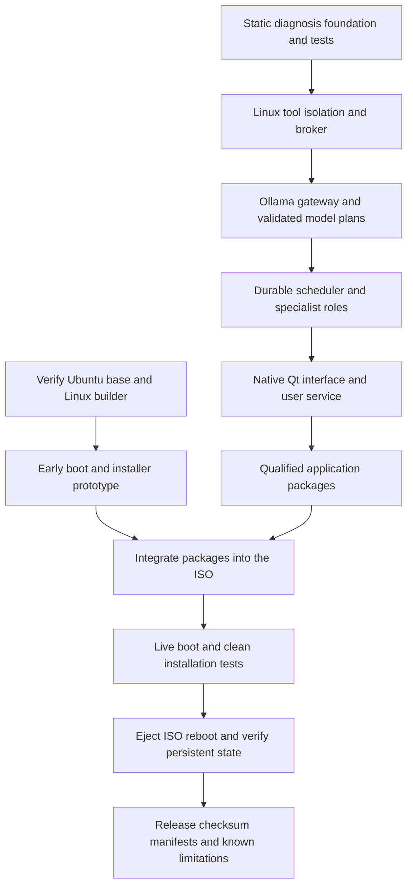

# NEXOS Build Workflow

## Current checkpoint on 19 October 2026

Implementation has started with a static diagnosis pipeline. It accepts an explicitly
granted project root and output directory, validates a deterministic plan, inspects
supported manifests, writes a report, verifies report and source hashes, and records
task events in SQLite. It does not yet perform natural language planning, execute
project code, start isolated workers or provide the native desktop.

Ten foundation tests pass on Windows with Python 3.12.14 and Ubuntu WSL with Python
3.12.3. They cover successful and failed task records, path scope, overwrite refusal,
symlink denial, oversized input, unregistered tools, dependency cycles, ignored
project instructions and tamper detection. These are foundation tests, not an agent
security benchmark or proof of Linux sandbox isolation.

A first `nexos-engine-foundation_0.1.0_all.deb` package has been built under Ubuntu
WSL. Its checksum and source hashes are recorded with the artifact. An extraction
smoke test verified the packaged version and diagnosis workflow without installing
the package on either host operating system.

## When to start

Start the core software and image inputs now. Begin a small boot prototype after
the base image and Linux builder are qualified. Assemble and qualify the complete
release ISO after its runtime packages, native desktop and service integration
work on a clean Ubuntu installation.

The presentation on 20 October is a proposal review. Use the prepared script and
explain the system design; no live project demonstration is needed. Present the
foundation accurately as an initial checkpoint if asked about progress.

## Build sequence



### Checkpoint 1 now

Use the current foundation to keep execution and outcome verification concrete.
Review the code and test results. The fixture in `examples/demo-project` is static
metadata and is not a running API application or a dependency installation target.

From the repository root in Ubuntu, using Python 3.12:

```bash
python3 tools/run_nexos.py diagnose --project examples/demo-project --output .nexos/reports --state .nexos/state.sqlite3
python3 -m unittest discover -s tests -v
python3 tools/build_foundation_deb.py
python3 tools/check_foundation_package.py
```

### Checkpoint 2 Linux boundary and builder

Add the actual Linux execution broker, sandbox startup checks, typed tool contracts
and testable capability rules. Keep the static adapters as fixtures for the planner.
Introduce schema validation using Pydantic when the model boundary is implemented.

The existing Ubuntu WSL environment supports tests and `dpkg-deb` packaging. The
19 October preflight found `mksquashfs` and `dpkg-deb`, while `cubic`, `xorriso` and
`bwrap` were absent from its executable search path. That is not yet a qualified
full desktop ISO builder. Cubic GUI availability, mounts and image assembly need
validation in WSL; a tested Ubuntu desktop VM is the primary fallback.

VMware Workstation is installed on Windows, but `vmrun list` could not start in the
current session. This does not establish that the desktop application or a guest
is broken. It means automated guest access has not been verified.

### Checkpoint 3 model and native desktop

Add Ollama health and model checks, bounded inference requests, validated plans and
specialist tool sets. Then implement the Qt desktop and private socket transport.
Integrate `nexosd` into the user session and the inference runtime into its service
account. Verify cancellation and restart handling before expanding workflows.

### Checkpoint 4 early image

Use `image/base-image.json` as the recorded candidate input. Download the declared
image to the chosen build volume, compare the complete file's SHA256 with the
published digest and authenticate the checksum signature using a trusted Ubuntu
image signing key. The candidate metadata is not a completed download or signature
verification. Reconfirm availability and record any deliberate base update.

In Cubic, apply version controlled package lists and overlays. Add the foundation
package only as an early integration test, with the pilot visibly labeled as
incomplete. Test that both live boot and installation retain the intended content.
Do not describe that pilot as the completed agentic distribution.

### Checkpoint 5 release image

Replace pilot content with qualified engine, desktop and integration packages.
Include Ollama runtime and first run setup in the Core image. The offline demo
variant additionally needs one tested model, its digest and appropriate
redistribution terms. Verify startup, model readiness, scoped tools and reports.

Test a new VM with the declared firmware and virtual hardware. Install to an empty
virtual disk, eject the ISO, reboot twice and check retained history and artifacts.
For the offline variant, disconnect networking and run its declared local task.
Preserve checksums, package and model versions, VM settings and failure evidence.

## Resource plan

The latest check observed about 94.3 GiB free on D and 13.5 GiB on C. These are
point in time values, not permanent capacity guarantees. Keep VM disks, ISO
downloads, Cubic work directories and exports on the selected build volume rather
than consuming the small remaining C drive space.

The laptop's 16 GB RAM supports a constrained development setup. Start with one
guest and one model request at a time. Budget approximately 100 to 120 GB of free
image build workspace for a comfortable iteration cycle, or use a separate builder
and retain only final artifacts locally. The current D space is close to that
estimate but needs monitoring; avoid simultaneous large snapshots, models and
multiple extracted images. No hardware purchase is required for the current
foundation work.

## Feature order

Build typed Linux tools, the broker, verification and restart behavior before adding
more autonomous actions. The next valuable features are action previews, reversible
file changes, saved routines and searchable evidence. Voice, multilingual input,
semantic search and more connectors follow those foundations.

## Ready for the next checkpoint

The current package proves a small CLI can be built and run from a Debian archive.
It does not yet qualify the application service or ISO. The next checkpoint is a
working Linux sandbox profile and a verified base image on an accessible builder.
The image tool dependencies are listed under `image/package-lists/`; the tools are
not installed automatically by this repository.
